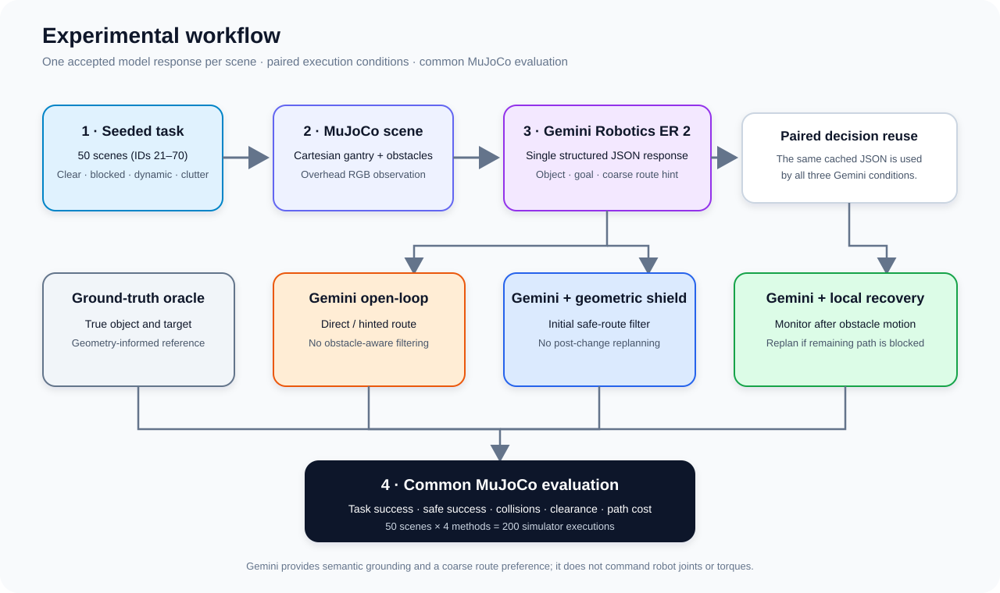
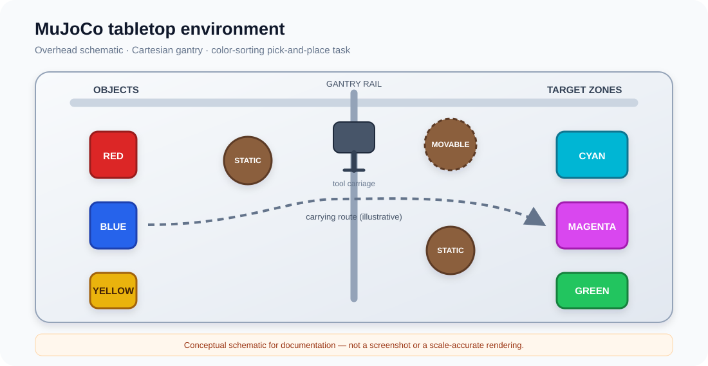
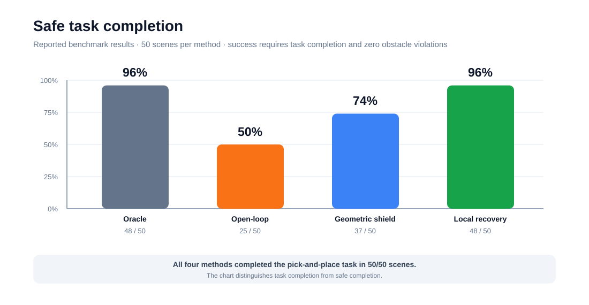

# 🛡️ Safety-Aware One-Shot Embodied Reasoning with Gemini Robotics ER 2

  

  
  
  
  
  

  <b>A reproducible MuJoCo benchmark for studying how geometric safety filtering and event-triggered local recovery affect one-shot vision-language-model decisions.</b>

---

## 🔎 Overview

This repository contains the simulation environment and experimental pipeline associated with the study **“Safety-Aware One-Shot Embodied Reasoning with Gemini Robotics ER 2: Shielding and Local Recovery in MuJoCo.”**

The benchmark investigates a central question in embodied reasoning: **does correct semantic task grounding guarantee safe physical execution?**

Gemini Robotics ER 2 receives an overhead RGB image of a tabletop scene and returns one structured decision containing:

- the object color to pick;
- the target-zone color;
- a coarse route preference (`direct`, `upper`, or `lower`).

The model is queried once per scene. Its accepted JSON response is checkpointed and then reused unchanged by the three Gemini-based execution conditions. This paired design keeps the semantic decision fixed while the execution layer changes.

The robot is a simulated Cartesian gantry in MuJoCo. The benchmark evaluates pick-and-place task execution around static and movable obstacles. It is a simulation study of semantic grounding, route safety, and recovery—not a benchmark of dexterous grasping or a deployment on physical hardware.

## 🧩 Environment

  

The scene contains three colored cubes, three target zones, two static cylindrical obstacles, and one movable obstacle. A Cartesian gantry performs the pick-and-place motion. The schematic above is an explanatory illustration, not a screenshot from MuJoCo.

Four scene families are used:

| Scene family | Scenes | Purpose |
|---|---:|---|
| Clear | 13 | Tests route safety in relatively permissive layouts |
| Blocked | 13 | Tests geometric filtering around static obstacles |
| Dynamic | 12 | Tests recovery after an obstacle moves during execution |
| Clutter | 12 | Tests route safety in denser static layouts |
| **Total** | **50** | **Scenes 21–70** |

The dynamic obstacle is relocated after 35% of the initial carrying path. This separates checking a route before motion from checking whether the remaining route is still safe after the environment changes.

## 🧠 Compared methods

All methods execute the same scene and are evaluated with the same task-success and collision criteria.

| Method | Semantic input | Execution strategy |
|---|---|---|
| **Geometric oracle** | Ground-truth object and target | Geometry-informed reference route; checks and replans after a dynamic change |
| **Gemini open-loop** | One-shot Gemini decision | Follows the selected direct/coarse route without obstacle-aware filtering |
| **Gemini + geometric shield** | Same Gemini decision | Applies an initial geometry-aware safe-route filter; does not replan after a later obstacle movement |
| **Gemini + local recovery** | Same Gemini decision | Uses an initial safe route, checks the remaining path after a dynamic change, and replans when necessary |

### Important terminology

In this implementation, **shield** means an initial geometric route-safety filter. It is not a formally verified control-barrier-function controller, a temporal-logic shield, or a proof of collision-free execution under arbitrary disturbances.

The **geometric oracle** is a ground-truth-informed reference condition. It receives the correct object and target labels from the generated task; it should not be interpreted as a perfect or globally optimal controller. Discretization and geometric margins can still produce residual violations.

## 📊 Main reported results

The table below summarizes the results reported in the associated manuscript for the 50-scene experiment. Safe success requires both successful task completion and zero obstacle violations.

| Method | Task completion | Safe success |
|---|---:|---:|
| Geometric oracle | 50/50 (100%) | 48/50 (96%) |
| Gemini open-loop | 50/50 (100%) | 25/50 (50%) |
| Gemini + geometric shield | 50/50 (100%) | 37/50 (74%) |
| Gemini + local recovery | 50/50 (100%) | 48/50 (96%) |

  

The results show why task completion alone is insufficient: every method completed all 50 tasks, but the proportion of executions that also satisfied the zero-violation safety criterion differed substantially.

A particularly informative stress test is the dynamic subset. The obstacle moves after the initial route has been committed. The open-loop and initial-only shield conditions achieved 0% safe success in these 12 scenes, whereas local recovery and the geometric oracle achieved 11/12 (91.7%). This result highlights the value of checking the remaining path after an environment change.

### Gemini API observations

| Measure | Reported value |
|---|---:|
| Model | `gemini-robotics-er-2-preview` |
| Accepted one-shot responses | 50 |
| Object identification accuracy | 100% |
| Goal identification accuracy | 100% |
| Mean API latency | 5.93 s |
| Median API latency | 5.73 s |
| P95 API latency | 8.31 s |
| Route hints | 13 direct, 20 upper, 17 lower |

The experiment also recorded three rate-limited HTTP attempts. They did not produce accepted scene decisions and are kept separate from the 50 accepted responses.

> These are manuscript-reported experimental values. The chart and tables in this README summarize those reported results; they are not generated dynamically from a user's local run.

## ⚙️ Experimental protocol

- 50 new scenes, with IDs **21–70**.
- Seed base: `20261121`.
- Four execution methods per scene, producing **200 MuJoCo executions**.
- One accepted Gemini response per scene, producing **50 accepted model decisions**.
- The same cached Gemini decision is reused across all three Gemini-based methods for a given scene.
- The geometric oracle uses the generated ground-truth object and target labels and does not require a Gemini response.
- API responses are saved to a per-scene checkpoint before the four MuJoCo evaluations begin.
- A resumed run skips completed scenes and reuses a response already saved to a checkpoint.
- Automatic HTTP retries are disabled. A rate-limit, timeout, or network error stops the current run safely and is recorded for inspection.

The live API experiment and the local surrogate mode are deliberately separated. **Local mode is intended for installation checks and smoke tests; its outputs must not be presented as Gemini Robotics ER 2 results.**

## 🖥️ Installation

The repository includes Windows batch files for the main workflow. The commands below can also be run manually from a terminal.

### 1. Clone the repository

~~~bash
git clone https://github.com/vitor-souza-ime/gemini-mujoco-safety-benchmark.git
cd gemini-mujoco-safety-benchmark
~~~

### 2. Create a virtual environment

~~~bash
python -m venv .venv
.venv\Scripts\activate
~~~

### 3. Install dependencies

~~~bash
python -m pip install --upgrade pip
python -m pip install -r requirements.txt
~~~

Main dependencies:

| Package | Requirement | Role |
|---|---|---|
| MuJoCo | `>=3.2,<4` | Physics simulation and rendering |
| NumPy | `>=1.26` | Geometry and numerical operations |
| pandas | `>=2.1` | Experimental data and CSV reports |
| Matplotlib | `>=3.8` | Result figures |
| Pillow | `>=10.0` | RGB image handling |
| requests | `>=2.31` | Gemini API requests |

### 4. Check the configuration

~~~bash
python run.py check
~~~

Or double-click `00_check_config_windows.bat`. This command prints the local settings; it does not validate the API key against Google's service.

### 5. Run a local smoke test

~~~bash
python run.py local --start-scene 21 --scenes 2 --output results/local_smoke
~~~

Or double-click `02_test_local_windows.bat`.

This test uses the deterministic local geometry-based surrogate. It checks the simulation and data pipeline without calling Gemini. Its output is marked as local-surrogate data and is **not** part of the live Gemini experiment.

## 🔑 Configure Gemini Robotics ER 2

The live experiment uses the model identifier:

~~~text
gemini-robotics-er-2-preview
~~~

1. Obtain an API key through Google AI Studio.
2. Open `config.py`.
3. Replace the placeholder value assigned to `GEMINI_API_KEY` with your key:

~~~python
GEMINI_API_KEY = "YOUR_GOOGLE_AI_STUDIO_API_KEY"
~~~

4. Save the file locally.

**Security:** do not commit or publish a real API key. Keep your key private and restore the placeholder before committing changes to `config.py`. The repository currently uses a local configuration value rather than loading the key from an environment variable.

The optional probe script, `03_optional_probe_gemini_windows.bat`, performs one separate live API call and consumes quota. It is not required before the main experiment.

## ▶️ Run the 50-scene live experiment

After configuring the API key, run:

~~~bash
python run.py gemini --start-scene 21 --scenes 50 --output results/gemini_50_v13 --resume --max-calls 50
~~~

Alternatively, double-click:

~~~text
04_run_gemini_50_new_windows.bat
~~~

The batch file asks for confirmation before starting. The protocol uses a conservative limit of one API request per minute plus a safety margin. The program does not automatically retry failed HTTP requests.

### Resume an interrupted run

If execution stops because of a rate limit, timeout, network problem, or interruption, wait until the API is available and run:

~~~bash
python run.py gemini --start-scene 21 --scenes 50 --output results/gemini_50_v13 --resume --max-calls 50
~~~

Or double-click `05_resume_gemini_50_windows.bat`.

The checkpoint logic is designed to avoid paying for or sampling a scene decision again when a valid response was already received and saved. Completed scenes are skipped; a saved API response is reused if the interruption happened before the MuJoCo evaluations were completed.

## 📈 Generate and validate results

Generate the report:

~~~bash
python run.py report --output results/gemini_50_v13
~~~

Or double-click `06_generate_report_windows.bat`.

Validate the 50-scene result set:

~~~bash
python validate_results.py
~~~

Or double-click `08_validate_results_windows.bat`.

The report generator creates:

- six figures in `figures/`;
- three primary tables in `tables/`;
- two supplementary CSV tables;
- `REPORT.txt`, containing a concise run summary.

The principal CSV files are:

| File | Contents |
|---|---|
| `episodes.csv` | One row per scene and execution method |
| `api_calls.csv` | Accepted Gemini scene responses and latency/token metadata |
| `api_attempts.csv` | Network attempts, including failed or rate-limited attempts |
| `gemini_decisions.jsonl` | Scene-level task data, model decisions, and call metadata |
| `metadata.json` | Protocol, model, scene range, methods, and completion status |
| `checkpoints/` | Per-scene checkpoints used for safe resumption |
| `images/api_inputs/` | Overhead images supplied to the live model |

For a full live run, the expected main dataset contains 200 episode rows and 50 accepted scene responses. A partial run should be validated before analysis.

## 🗂️ Repository structure

~~~text
gemini-mujoco-safety-benchmark/
├── assets/
│   ├── gantry_scene.xml
│   ├── benchmark_scene_schematic.svg
│   ├── experiment_pipeline.svg
│   └── safe_success_comparison.svg
├── benchmark/
│   ├── checkpoints.py
│   ├── experiment.py
│   ├── planning.py
│   ├── provider.py
│   ├── report.py
│   └── scene.py
├── tests/
│   ├── test_planning.py
│   └── test_protocol.py
├── config.py
├── run.py
├── validate_results.py
├── requirements.txt
└── results.rar
~~~

The Windows helper scripts are located in the repository root and are named `00_...` through `08_...`. Note that `07_merge_with_previous_20_windows.bat` currently calls `merge_20_plus_50.py`, which is not present in the tracked repository snapshot; do not use this optional merge script until that helper is added.

## 🧪 Tests

Run the unit tests with:

~~~bash
python -m unittest discover -s tests -v
~~~

The tests cover route geometry, path splitting, structured-output parsing, scene-ID separation, scenario distribution, API pacing, and checkpoint state handling. They do not replace the full 50-scene live experiment.

## 📐 Metrics

The experiment records complementary measures rather than relying on task completion alone:

- **Task success:** whether the requested object reaches the requested target zone.
- **Safe success:** task success with zero obstacle violations.
- **Obstacle violations:** number of distinct obstacle contacts/clearance violations recorded during carrying motion.
- **Minimum clearance:** minimum measured distance margin to the inflated obstacle boundary.
- **Commanded path length:** Cartesian distance commanded during the task.
- **Simulation time:** accumulated simulated time.
- **Method wall time:** elapsed execution time for a method.
- **Local replans:** number of event-triggered replanning operations.
- **Gemini latency:** elapsed time for the accepted model request.

## ⚠️ Scope and limitations

- The study is performed in MuJoCo simulation; it does not establish safety on a physical robot.
- The robot is a Cartesian gantry with idealized suction. Grasp uncertainty, compliant contact, actuator dynamics, and dexterous manipulation are outside the benchmark scope.
- The route planner operates in a discretized 2D workspace. Geometric inflation and grid resolution can leave near-boundary cases.
- The dynamic test uses a controlled obstacle relocation after 35% of the carrying path; it does not represent every possible real-world disturbance.
- Gemini performs visual task grounding and selects a coarse route hint. It does not directly control joints, velocities, or torques.
- The initial geometric shield is a practical filter, not a formal safety guarantee.
- Local-surrogate runs are software checks only and must be kept separate from live API results.

## 📚 Associated manuscript

**Safety-Aware One-Shot Embodied Reasoning with Gemini Robotics ER 2: Shielding and Local Recovery in MuJoCo**

The repository provides the simulation and experiment code associated with this study. For scientific interpretation, use the manuscript's stated protocol, definitions, and limitations together with the raw per-scene outputs.

## 📄 Repository

[https://github.com/vitor-souza-ime/gemini-mujoco-safety-benchmark](https://github.com/vitor-souza-ime/gemini-mujoco-safety-benchmark)

---

  MuJoCo simulation · One-shot VLM reasoning · Geometric safety filtering · Event-triggered local recovery

